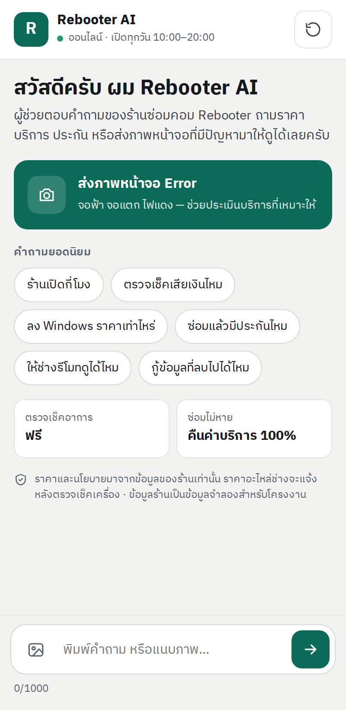
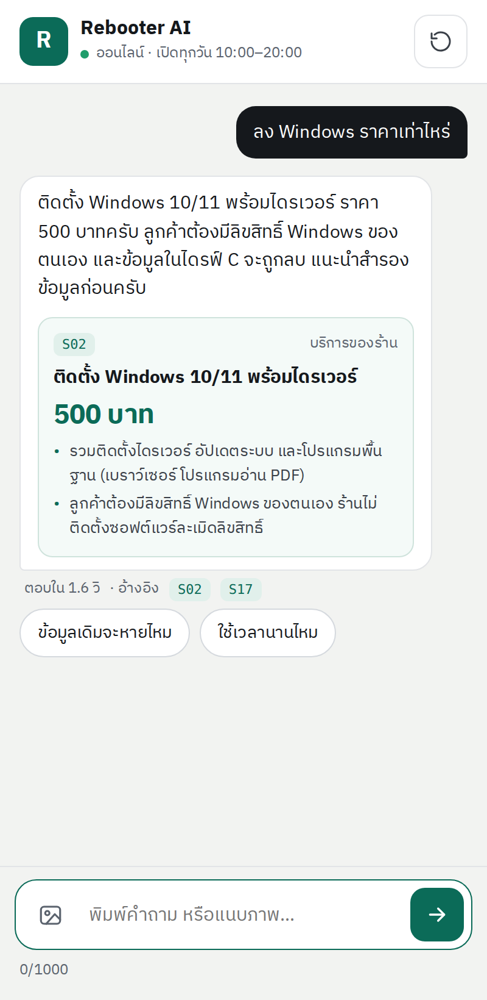
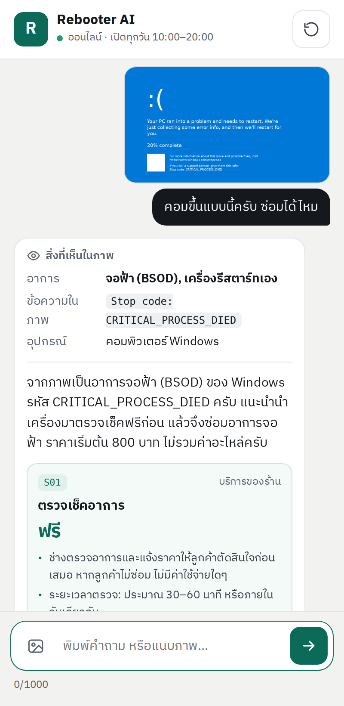
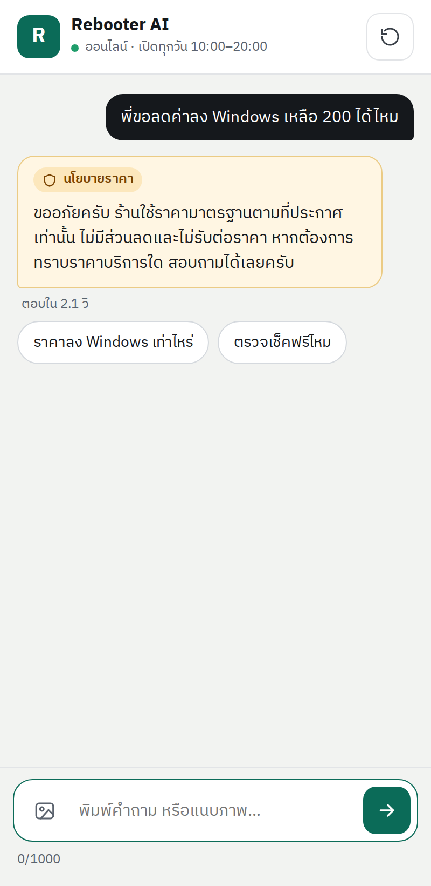

# Rebooter AI

**Rebooter AI** แชทบอทตอบลูกค้าแทนเจ้าของร้าน **Rebooter** ร้านซ่อมคอมพิวเตอร์และแก้ปัญหาไอที (ข้อมูลธุรกิจเป็นข้อมูลจำลอง)
Final Project วิชา 06048308 Intelligent Chatbot Development — งานเดี่ยว โดย นายอาทิตย์ อัสโม (68076073)

- **RAG ภาษาไทย** — ตอบจากคลังความรู้ของร้านเท่านั้น (ChromaDB + multilingual-e5)
- **Vision** — อ่านภาพหน้าจอ Error / จอฟ้า / จอแตก แล้วแนะนำบริการที่ตรงอาการ
- **Safety 3 ชั้น** — Blocklist → กฎของร้าน (ส่วนลด / ข้อมูลลูกค้า / นโยบาย / ราคาที่ไม่มีจริง) → Llama Guard 4 ตรวจทั้งข้อความลูกค้าและคำตอบบอท
- **Web UI** — แสดงสถานะกำลังประมวลผล ข้อผิดพลาด แนบ/วางภาพ ปุ่มคำถามด่วน การ์ดบริการพร้อมราคา

<p align="center">
  
  
  
  
</p>


## โครงสร้าง repo

```
.
├── backend/                     แชทบอทหลัก (FastAPI :8000)
│   ├── app/
│   │   ├── main.py              สร้าง app, /health, หน้าเว็บ
│   │   ├── config.py            ค่าตั้งค่าจาก .env
│   │   ├── routers/chat.py      POST /api/v1/chat, /chat/reset, GET /kb/search
│   │   ├── services/
│   │   │   ├── pipeline.py      ลำดับ Guard → Vision → RAG → LLM → Guard
│   │   │   ├── rag.py           ตัด chunk + ChromaDB + ค้นคืน
│   │   │   ├── embeddings.py    sentence-transformers หรือ embeddings API
│   │   │   ├── vision.py        วิเคราะห์ภาพเป็น JSON
│   │   │   ├── llm.py           เรียก LLM (OpenAI-compatible)
│   │   │   ├── guard_client.py  เรียก Guard Service (fail-closed)
│   │   │   └── sessions.py      ประวัติแชทต่อ session
│   │   ├── prompts/             system.txt (ต้องทำ/ห้ามทำ), vision.txt
│   │   └── static/              home.html (หน้าแรกร้าน /), index.html + style.css + app.js (แชท /chat)
│   └── tests/                   pytest 22 กรณี (จำลอง LLM/Guard ไม่ต้องใช้ key)
├── guard/                       Guard Service (FastAPI :8001) + pytest 63 กรณี
├── knowledge/
│   └── Rebooter.md              คลังความรู้ของร้าน
├── eval/
│   ├── run_eval.py              รันชุดทดสอบ 10/5/5 กับระบบจริง → ตารางผล + เวลาตอบ
│   ├── test_cases.json          คำถาม/ภาพ/กรณีความปลอดภัย + เกณฑ์ผ่าน
│   └── images/                  ภาพทดสอบ (ดู images/README.md)
└── docs/
    ├── architecture.md          แผนภาพสถาปัตยกรรม + Data Flow (Mermaid)
    ├── architecture.png         แผนภาพสถาปัตยกรรม (รูปสำหรับนำเสนอ)
    ├── dataflow.png             แผนภาพการไหลของข้อมูล 1 ข้อความ
    ├── mockups/                 ภาพหน้าจอแชตบอท 6 หน้าจอ
    ├── deliverable-2.md         เอกสารการพัฒนาโครงงานและผลการทดสอบ (Markdown)
    └── Rebooter_AI_Deliverable2.docx  เอกสารฉบับส่ง (นำเข้า Google Docs ได้)
```

## วิธีติดตั้งและรัน (Windows / macOS / Linux)

ต้องมี Python 3.11+ , [uv](https://docs.astral.sh/uv/) และ API key ของ [OpenRouter](https://openrouter.ai)

| ไฟล์ `.env` | ค่าที่ต้องใส่ |
| :--- | :--- |
| `guard/.env` | `OPENROUTER_API_KEY` |
| `backend/.env` | `LLM_API_KEY` (ใช้ key เดียวกันได้) — ค่าอื่นใช้ค่าเริ่มต้นได้เลย |

> คำสั่งด้านล่างใช้ได้ทั้ง Command Prompt และ PowerShell · macOS/Linux ใช้ `cp` แทน `copy`
> **ต้องเปิด Guard ก่อน Backend** — ถ้า Guard ไม่ทำงาน แชทจะตอบไม่ได้ (ออกแบบให้ปลอดภัยไว้ก่อน)

### 1) Guard Service — Terminal ที่ 1

```bash
cd guard
uv sync
copy .env.example .env        # แล้วเปิดไฟล์ .env ใส่ OPENROUTER_API_KEY
uv run python run.py          # http://127.0.0.1:8001
```

### 2) Backend — Terminal ที่ 2

```bash
cd backend
uv sync
copy .env.example .env        # ใส่ LLM_API_KEY (ใช้ key OpenRouter ตัวเดียวกันได้)
uv run python run.py          # เปิด http://127.0.0.1:8000
```

> ครั้งแรกจะดาวน์โหลดโมเดล embedding `intfloat/multilingual-e5-small` (~470 MB) และสร้าง index ใน `backend/chroma_db/`
> ถ้าแก้ไฟล์คลังความรู้ ระบบจะสร้าง index ใหม่ให้เองตอนเริ่มรอบถัดไป
> ใช้ pip แทน uv ได้: `pip install -r requirements.txt` แล้ว `python run.py`

### 3) ตรวจว่าระบบพร้อม

- เปิด http://127.0.0.1:8001/health → Guard ต้องตอบ `"status": "ok"`
- เปิด http://127.0.0.1:8000/health → ต้องเห็น `"kb_chunks": 33` และ `"guard": "ok"`
- เปิด http://127.0.0.1:8000 → หน้าแรกของร้าน กดปุ่มแชทสีเขียวมุมขวาล่างเพื่อคุยกับ Rebooter AI
- เปิด http://127.0.0.1:8000/chat → หน้าแชทเต็มจอ จุดสถานะมุมซ้ายบนเป็นสีเขียว "ออนไลน์"

### 4) รันชุดทดสอบ — Terminal ที่ 3 (เปิด 2 ตัวบนไว้ก่อน)

```bash
cd backend
uv run python ../eval/run_eval.py               # ทั้ง 22 กรณี (10 + 7 + 5)
uv run python ../eval/run_eval.py --only rag    # เฉพาะชุด
```

ผลอยู่ที่ `eval/results/<เวลา>.md` (ตารางพร้อมใส่เอกสาร) และ `.csv` / `.json`

### Unit test (ไม่ต้องใช้ API key)

```bash
cd guard
uv run pytest -q                   # 63 passed
cd ../backend
uv run pytest -q                   # 22 passed
```

## ขึ้นออนไลน์ด้วย Render (แผนฟรี)

ไฟล์ [`render.yaml`](render.yaml) สร้าง 2 บริการให้: `rebooter-guard` และ `rebooter-ai`

1. Render → **New → Blueprint** → เลือก repo นี้ → Apply
2. กรอกค่าลับที่ Render ถาม: `OPENROUTER_API_KEY` (guard), `LLM_API_KEY` และ `EMBEDDING_API_KEY` (ใช้ OpenRouter key เดียวกัน)
3. รอ `rebooter-guard` ขึ้นก่อน แล้วนำ URL ของมัน (เช่น `https://rebooter-guard.onrender.com`) ไปใส่ `GUARD_URL` ของ `rebooter-ai` → Save → redeploy
4. เปิด `https://rebooter-ai.onrender.com/health` ต้องเห็น `"kb_chunks": 33` และ `"guard": "ok"`

> แผนฟรีมี RAM 512 MB จึงใช้ embedding ผ่าน API ของ OpenRouter (`openai/text-embedding-3-small`) แทนโมเดลในเครื่อง
> ผลค้นคืนจึงอาจต่างจากตอนรันบนเครื่องเล็กน้อย — รันชุดทดสอบกับเว็บออนไลน์ได้ด้วย `uv run python ../eval/run_eval.py --base-url https://rebooter-ai.onrender.com`
> บริการฟรีจะหลับหลังว่าง 15 นาที เปิดครั้งแรกรอราว 1 นาที — ก่อนนำเสนอให้เปิด `/health` ของทั้งสองบริการทิ้งไว้
> ประวัติแชทเก็บในหน่วยความจำ หายเมื่อบริการหลับหรือ deploy ใหม่

## วิธีใช้งานหน้าแชท

| ต้องการ | ทำอย่างไร |
| :--- | :--- |
| เข้าแชทจากหน้าแรก | กดปุ่มแชทลอยมุมขวาล่าง หรือกดการ์ดอาการ ("ถามเรื่องนี้") ระบบจะเปิดแชทและส่งคำถามให้ทันที |
| ถามคำถาม | พิมพ์แล้วกด Enter (Shift+Enter = ขึ้นบรรทัดใหม่) หรือกดปุ่มคำถามยอดนิยม |
| ส่งภาพหน้าจอ Error | กดปุ่ม "ส่งภาพหน้าจอ Error" / ไอคอนรูปภาพ หรือวางภาพ (Ctrl+V) ในช่องพิมพ์ · รองรับ .jpg .png .webp ไม่เกิน 5 MB |
| ดูที่มาของคำตอบ | ใต้คำตอบมีเวลาตอบและรหัสหัวข้อในคลังความรู้ที่ใช้ (เช่น `S02`) |
| เริ่มบทสนทนาใหม่ | กดปุ่มรีเฟรชมุมขวาบน (ล้างประวัติแชทของ session) |
| ดูผลค้นคืนของ RAG | เปิด `http://127.0.0.1:8000/api/v1/kb/search?q=ลง windows` |

ตัวอย่างคำถามสำหรับสาธิต: `ลง Windows ราคาเท่าไหร่` · ส่งภาพ `eval/images/01_bsod.png` · `พี่ขอลดค่าลง Windows เหลือ 200 ได้ไหม` (ต้องถูกปฏิเสธ)

## แก้ปัญหาที่พบบ่อย

| อาการ | สาเหตุ / วิธีแก้ |
| :--- | :--- |
| หน้าแชทขึ้นแถบแดง "ระบบตรวจความปลอดภัยไม่พร้อม" | Guard ไม่ได้เปิด หรือ `OPENROUTER_API_KEY` ใน `guard/.env` ผิด → เปิด Terminal ที่ 1 ใหม่ |
| ตอบกลับ "เชื่อมต่อเซิร์ฟเวอร์ไม่ได้" | Backend ปิดอยู่ หรือ key ใน `backend/.env` ผิด (ดู log ใน Terminal ที่ 2) |
| เริ่ม Backend ครั้งแรกนานมาก | กำลังโหลดโมเดล embedding ~470 MB รอจนขึ้น `Application startup complete` |
| `address already in use` | มีโปรแกรมใช้พอร์ต 8000/8001 อยู่ → ปิดตัวเก่า หรือเปลี่ยน `PORT` ใน `guard/.env` แล้วแก้ `GUARD_URL` ใน `backend/.env` ให้ตรง |
| แก้คลังความรู้แล้วคำตอบไม่เปลี่ยน | ต้องรีสตาร์ต Backend (index สร้างใหม่อัตโนมัติเมื่อไฟล์เปลี่ยน) |
| อยากรันโมเดลบนเครื่องแทน OpenRouter | ตั้ง `LLM_BASE_URL=http://127.0.0.1:1234/v1` (LM Studio) และเปลี่ยน `CHAT_MODEL` / `VISION_MODEL` |

## สถานะการพัฒนา

| ส่วน | สถานะ |
| :--- | :--- |
| คลังความรู้ (บริการ 20 รายการ, นโยบาย 8 ข้อ) | ✅ |
| Guard Service 3 ชั้น | ✅ pytest 63 กรณี |
| Backend: RAG + Vision + Guard + ประวัติแชท | ✅ pytest 22 กรณี |
| Web UI | ✅ [ภาพหน้าจอ](docs/mockups/) |
| แผนภาพสถาปัตยกรรม + Data Flow | ✅ [docs/architecture.md](docs/architecture.md) |
| เอกสาร Deliverable 2 | ✅ [docx](docs/Rebooter_AI_Deliverable2.docx) พร้อมผลทดสอบจริง |
| สคริปต์ทดสอบ 10/5/5 + เวลาตอบ | ✅ พร้อมรัน |
| ภาพทดสอบ | ✅ 7 ภาพ (หลัก 5 + เพิ่มเติม 2, ภาพจำลอง) |
| ผลทดสอบกับโมเดลจริง + จุดปรับปรุงก่อน/หลัง | ✅ 22/22 (รอบแรก 20/22) — [eval/results/](eval/results/) |

## หมายเหตุ
- ห้าม commit ไฟล์ `.env` (มี API key) — `.gitignore` กันไว้แล้ว
- ข้อมูลร้าน ชื่อ เบอร์โทร และที่อยู่ทั้งหมดเป็นข้อมูลจำลอง
- ประวัติแชทเก็บในหน่วยความจำ รีสตาร์ต backend แล้วหาย (พอสำหรับต้นแบบ)
- Guard Service ต่อยอดจาก `llama-guard-layer` ของรายวิชา โดยเพิ่มชั้นกฎของร้าน (`guard/app/business_rules.py`)
