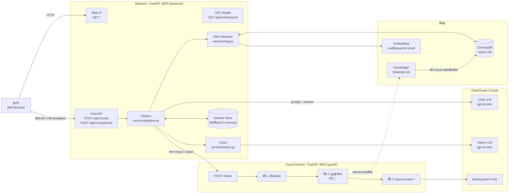
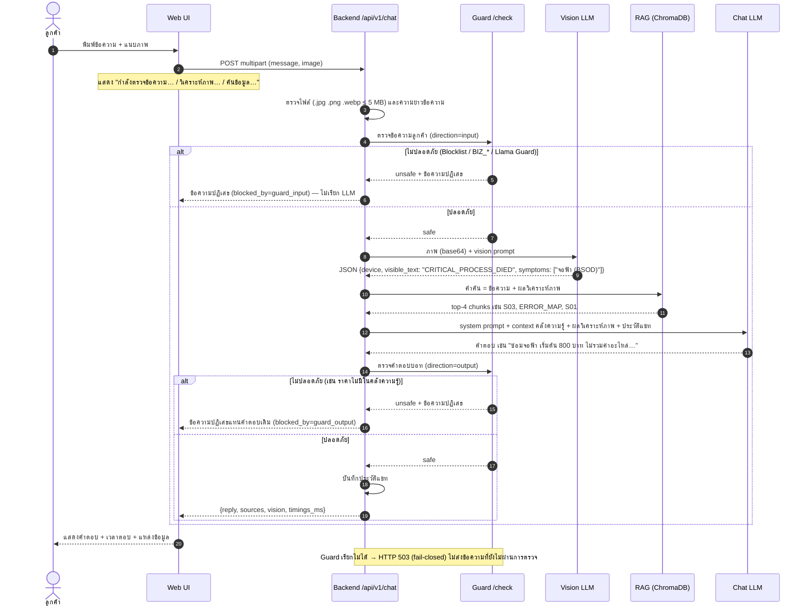

# แผนภาพระบบ Rebooter AI

แผนภาพทั้งสองตรงกับโค้ดใน repo นี้ (GitHub แสดงผล Mermaid ได้ทันที / ส่งออกเป็นรูปได้ที่ https://mermaid.live)

## 1. แผนภาพสถาปัตยกรรม (Architecture)

| ส่วนประกอบ | หน้าที่ | ไฟล์ |
| :--- | :--- | :--- |
| Web UI | หน้าแชท แสดงสถานะกำลังประมวลผล ข้อผิดพลาด แนบภาพ ปุ่มคำถามด่วน | `backend/app/static/` |
| Chat API | รับข้อความ/ภาพ ตรวจรูปแบบไฟล์และขนาด จัดการ session cookie | `backend/app/routers/chat.py` |
| Pipeline | ควบคุมลำดับ Guard → Vision → RAG → LLM → Guard และจับเวลาแต่ละขั้น | `backend/app/services/pipeline.py` |
| Vision | ส่งภาพให้ Vision LLM สรุปเป็น JSON (อุปกรณ์ ข้อความ Error อาการ) | `backend/app/services/vision.py` |
| RAG | ตัดคลังความรู้ตามหัวข้อ `##` → embedding → ChromaDB → ค้น top-k | `backend/app/services/rag.py` |
| Guard Service | ตรวจข้อความ 3 ชั้น ตอบ safe/unsafe + ข้อความปฏิเสธภาษาไทย (fail-closed) | `guard/app/` |
| Knowledge Base | ข้อมูลร้าน บริการ 20 รายการ นโยบาย 8 ข้อ ตาราง Error→บริการ | `knowledge/Rebooter.md` |

### Endpoint ทั้งหมด

| Service | Method | Path | หน้าที่ |
| :--- | :--- | :--- | :--- |
| Backend | GET | `/` | หน้าแรกของร้าน + ปุ่มแชทลอย |
| Backend | GET | `/chat` | หน้าแชท |
| Backend | GET | `/health` | สถานะระบบ จำนวน chunk และสถานะ Guard |
| Backend | POST | `/api/v1/chat` | ส่งข้อความ (`message`) และ/หรือภาพ (`image`) แบบ multipart |
| Backend | POST | `/api/v1/chat/reset` | ล้างประวัติแชทของ session |
| Backend | GET | `/api/v1/kb/search?q=` | ดูผลค้นคืนของ RAG (ใช้ทดสอบ/สาธิต) |
| Guard | POST | `/check` | ตรวจข้อความ `{message, direction: input/output}` |
| Guard | GET | `/health` | สถานะ Guard |

## 2. แผนภาพการไหลของข้อมูล 1 ข้อความ (Data Flow)

ตัวอย่าง: ลูกค้าส่งภาพจอฟ้าพร้อมข้อความ "คอมขึ้นแบบนี้ครับ ซ่อมได้ไหม"

